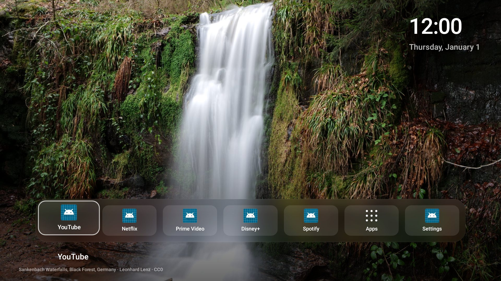
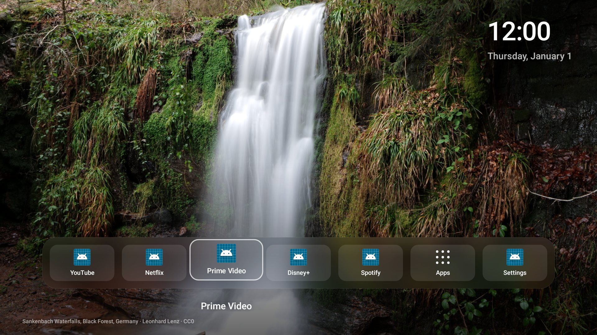
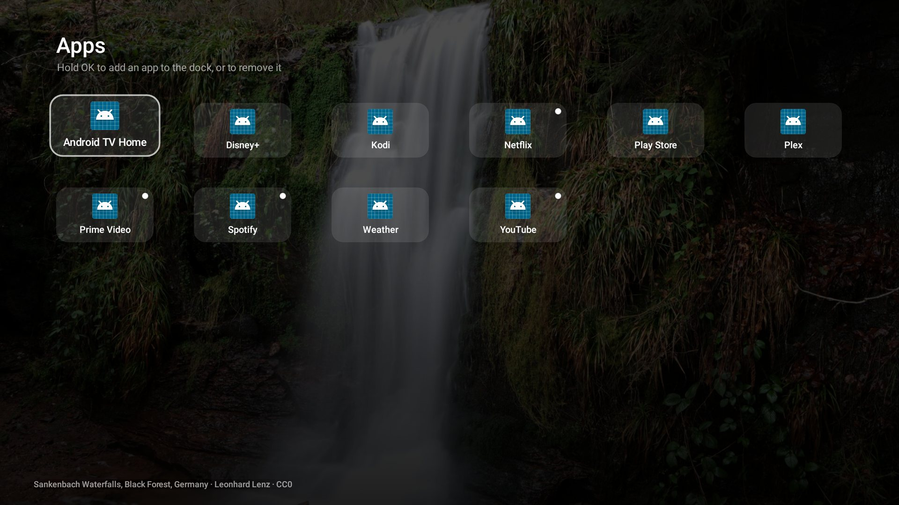

# Glass Home for Android TV

The Android TV and Google TV counterpart of [Glass Home](../README.md): a tool
that finds your TV on the Wi-Fi, backs it up, switches off the maker's ads,
telemetry and junk (reversibly), and installs a fast, minimal Apple TV-style
home screen with a dock of your favourite apps and rotating nature photos.



> **Status.** Built and tested without a TV: the tool (`atv.py`) and its
> restore script pass an end-to-end suite against a simulated Google TV
> (`dev/fake_adb.py`), and the home screen's real code runs on Robolectric's
> Android 14 framework, which also drew these screenshots. Real apps show their
> own TV banners; the green placeholders above are the test's made-up apps.
> **It has not yet run on a real TV.** The first run on yours is the real test,
> which is why every step is backed up, screenshotted, and undoable.

## What you need

- A computer on the same Wi-Fi as the TV, with Python 3.8+ and Google's `adb`:
  macOS `brew install android-platform-tools`; Windows
  `winget install Google.PlatformTools`; Debian/Ubuntu `sudo apt install adb`.
- To build the home screen: a JDK (17+), plus either Android Studio's SDK, or on
  Debian/Ubuntu `sudo apt install aapt apksigner zipalign dalvik-exchange android-sdk-platform-23`.
- On the TV, developer options with network debugging:
  1. **Settings > System** (or Device Preferences) **> About**, select **Build**
     (or **Android TV OS build**) seven times until it says you're a developer.
  2. **Settings > System > Developer options**: turn on **USB debugging**, and
     **Network debugging** (called ADB over network on some TVs).
  3. Newer Google TV (Android 11+) may only offer **Wireless debugging**: turn it
     on, choose **Pair device with pairing code**, and use `atv.py pair` below.

## Step by step

```sh
cd android-tv
./atv.py discover              # finds TVs on your network, says which accepts adb
./atv.py connect 192.168.1.50  # the TV asks "Allow USB debugging?": tick Always, Allow
./atv.py backup                # packages, settings, home screen + restore.sh
./atv.py audit                 # what's on it and what could go, with reasons
./atv.py debloat               # asks you, disables, checks, screenshots each step
launcher/build.sh              # builds Glass Home (launcher/build/glass-home.apk)
./atv.py install-home          # installs it, proves it starts, makes it the home screen
```

Wireless debugging instead: `./atv.py pair 192.168.1.50:37123 123456` (the
address and code on the pairing screen), then `./atv.py connect` with the address
shown on the Wireless debugging screen.

Everything lands in `android-tv/state/<model>-<serial>/` (git-ignored):
`backups/<time>/` with `restore.sh`, `shots/` with every screenshot in order,
and `journal.jsonl` with every change.

### What debloat asks

It groups what it finds and asks before each group:

| Group | Asked | Examples |
|---|---|---|
| Ads and promoted content | once for the group (all / one by one / none) | Android ad services, Sony Select, old Android TV recommendation rows |
| Telemetry | once for the group | Google feedback, bug report sender, Samba TV (content recognition), Xiaomi analytics, NVIDIA stats |
| Junk | once for the group | printing services, the Easter egg |
| Things you might use | **each one**, default No, with what you'd lose | Google Assistant/voice search, Chromecast built-in, Ambient mode, preinstalled streaming apps, Android TV Core Services |
| Unknown but suspicious | **each one**, default No | maker packages not in the catalogue whose names say ads, analytics, promo, metrics... |
| Animation speed | yes/no | 0.5 makes menus and app switches feel about twice as quick |
| Ad-blocking DNS | yes/no (Android 9+) | Private DNS with AdGuard DNS: blocks ad and tracker servers for the whole TV; checked and switched back if the TV can't resolve names |

The full list, with the reason for each, is [`catalog.json`](catalog.json).
Packages it doesn't know and that don't look like ads or tracking are never
touched; `./atv.py audit --all` lists them so you can look.

**Reviewing a plan instead of answering prompts** (also how a Claude Code session
on your computer can ask you in chat first):

```sh
./atv.py audit --write-plan plan.json   # ads/telemetry/junk true, everything else false
# edit plan.json: set "disable": true/false, "animation_scale": 0.5, "private_dns": "dns.adguard-dns.com"
./atv.py debloat --plan plan.json
```

### The home screen

`install-home` installs Glass Home, starts it and checks it's in front (and stops,
changing nothing else, if not), then makes it the default home screen and presses
Home. Many Google TV devices ignore that default while their own home screen is
enabled. In that case it explains the trade-off and **asks** before disabling the
stock home screen (`--disable-stock yes|no` to answer in advance). It then
checks that Home opens Glass Home, and re-enables the stock one at once if not, so
the TV is never left without a home screen.

| Remote | What happens |
|---|---|
| Left / Right | along the dock |
| OK | open |
| Hold OK on a dock app | Move left, Move right, Remove from dock, App info |
| OK on **Apps** | every app; hold OK to add one to the dock or remove it |
| Back | closes Apps; otherwise nothing (it's home) |
| Home | back to the start of the dock |

- Twelve CC0 nature photos ([credits](../CREDITS.md)) crossfade every 45
  seconds with a slow drift, shuffled once a day. Add your own with
  `./atv.py photos ~/Pictures/*.jpg`.
- Clock and date; after 3 minutes idle only the photo stays, and the first key
  press just brings the dock back.
- The first dock is the streaming apps you have (YouTube, Netflix, Prime Video,
  Disney+...), then **Apps** and **Settings** (always there, so Settings can't be lost).
- No network access, no tracking, no libraries; one 5 MB APK, nearly all photos.
  Disabled apps drop out of the dock and come back in their place when re-enabled.

| | |
|---|---|
|  |  |

## Undo

```sh
sh state/<model>-<serial>/restore.sh            # newest backup; or the one in any backups/<time>/
sh state/<model>-<serial>/restore.sh --remove-glass-home
./atv.py restore                                # the same from Python (Windows)
```

It re-enables every app that was on at the backup and is off now, puts back every
setting atv.py changed (unset ones are deleted again), makes the original home
screen the default, presses Home and saves a screenshot. It needs only adb.

## Safety

- Never uninstalls: `pm disable-user` only (the same as Settings > Apps > Disable).
- Won't change anything until a backup of that TV exists; a plan written for one
  TV is refused on another.
- Never touches the system, Google Play services, the Play Store, keyboards,
  Settings, remote, setup, update or TV-input packages, even if a plan lists them.
- After each group it checks that Home still answers and the system UI is
  running, and re-enables the group if not.
- A screenshot from the TV after every step. Protected video (Netflix and so on)
  shows as black in screenshots: that's the TV, not a fault.

## Limits

- It can't remove ads inside apps or streams (YouTube's own ads, for example).
- Some makers refuse to disable some packages (`pm` says so; the tool reports it
  and carries on).
- A big system update can re-enable packages or the stock home screen. Run
  `backup` and `debloat` again afterwards.
- Fire TV (Fire OS) isn't Android TV: debloating works, but Fire OS ignores other
  home screens (`install-home` checks and rolls back).
- With the Google TV home screen disabled, its For You, Live and profile features
  are gone until you re-enable it (restore.sh).

## With Claude Code on your computer

This session's cloud container can't reach your home network, so the TV steps
have to run on a computer there. Run `claude` in this folder on that computer
(or `claude remote-control` to follow along from your phone) and ask it to work
through the steps above. It can read each screenshot in `state/.../shots/` to
check the TV, and use `audit --write-plan` to ask you about each app in chat
before running `debloat --plan`.

## Files

| | |
|---|---|
| `atv.py` | the tool (standard-library Python) |
| `catalog.json` | known packages, grouped, with reasons |
| `launcher/` | the home screen: plain Java, no libraries; `build.sh` builds it with the SDK tools, no Gradle |
| `launcher/tools/make-icons.py` | the icon and TV banner from `assets/icon-1024.png` (Pillow; output committed) |
| `dev/test_atv.py` | end-to-end tests of atv.py and restore.sh against `dev/fake_adb.py` |
| `dev/render.sh` | builds the app and runs it on Robolectric, saving screenshots to `state/render/` |

```sh
python3 dev/test_atv.py   # no TV needed
dev/render.sh             # needs Maven and JDK 17+
```

The render test compiles against Robolectric's `android-all`, and uses small
stand-ins for the few `androidx.test` classes Robolectric calls
(`dev/robolectric/src/test/java/androidx/`), because those are only on Google's
Maven. `build.sh` was tested with Debian's tools (dx); with Android Studio's SDK
it uses d8 instead, which hasn't been tried yet.
